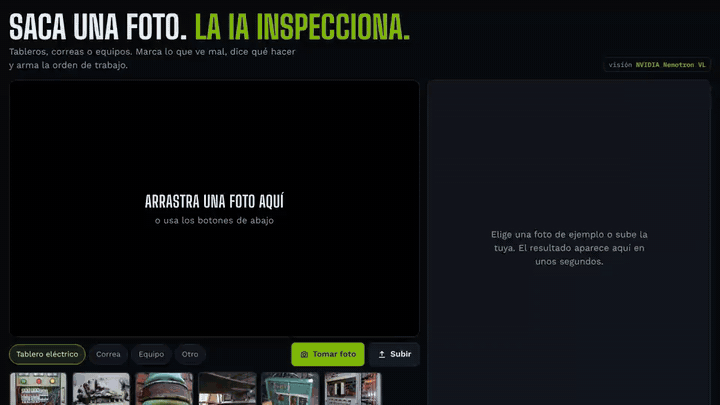
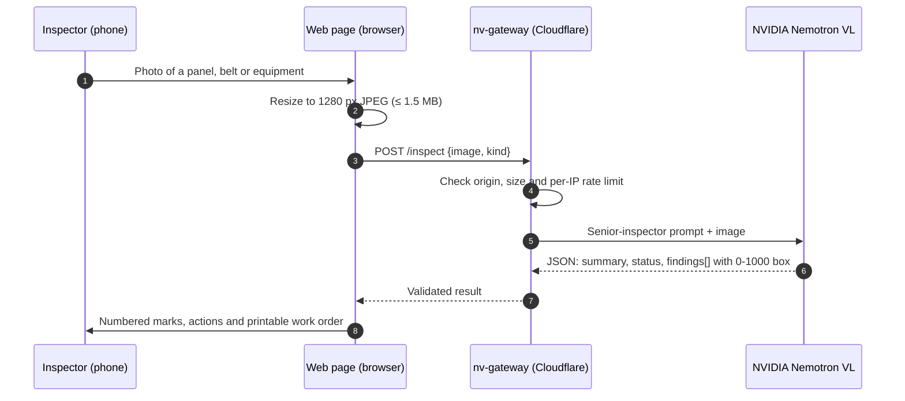

# Field Inspector

**Take a photo of an electrical panel, a conveyor belt or a piece of equipment. The AI marks what looks wrong, says what to do and drafts the work order.**

[Español](README.md) · **English**

> The interface is in Spanish (built for Chilean mining and industry).

## The problem

A field inspection ends up as a phone photo and a note someone types up later. Context gets lost, severity depends on who wrote it, and the work order arrives late.

## How it works

Each finding comes back with **title, detail, severity (high, medium, low), a concrete action and its bounding box** in normalized coordinates. The page draws the boxes and builds the work order. The model also states **what the photo cannot confirm**, so it doesn't make things up.

## Design decisions

| Decision | Why |
|---|---|
| The page never sees the NVIDIA key | It is a secret in [nv-gateway](https://github.com/JSNN15/nv-gateway), which only accepts this site and rate-limits requests. |
| Prompt depends on the asset type | Panels, belts and rotating equipment fail differently, so the checklist changes. |
| JSON output with 0-1000 boxes | Resolution-independent; the page draws without trusting the model for rendering. |
| Retry on malformed JSON | The gateway repairs trailing commas or asks once more. |
| Cached examples | The 17 sample photos (panels, valves, cable pits, flooded galleries, structures) load instantly without using API calls; your own photo does call the AI. |
| Live camera | The Camera button opens the phone, tablet or PC camera in the page (getUserMedia, rear camera by default) and analyzes the captured frame. If the browser does not allow it, it falls back to the system camera. |

## Limits

- The AI only sees the photo: no temperature, torque or insulation readings. It is a first filter, not a replacement for instrument-based inspection.
- Severity is the model's proposal; the inspector decides.
- Boxes are approximate: good for locating, not for measuring.

## Files

| File | What it is |
|---|---|
| `index.html` | The whole tool: UI, mark rendering and work order. No build, no dependencies. |
| `s/` | Sample photos with their cached result. |
| `docs/` | Demo GIF and diagrams. |

Run locally: `python3 -m http.server 8770` and open `http://localhost:8770`. Local calls go to `http://localhost:8787`, where `nv-gateway` runs with `node dev.mjs`.

## Credits

Sample photos (their authors' licenses, not Apache-2.0): *Electrical Panel* (peretzp), *square-d distribution board* (h080), *Green is the colour of...* (Jens Rost), *Electric panel* (sparr0), *Open room distribution board* (seeweb), all CC BY-SA 2.0 via Openverse; belt frame from BeltCrack (Huang et al., 2026, CC BY-SA 4.0). Also via Openverse: *Old Fuse Box* (chrstphre), *DSC00360* (dcmorton), *09. Water Pumped out of Tracks* (MTAPhotos), *6120 old fuse box* (crabchick), *Chambre bien remplie* (Point d'Appui National ANT), *Old Columbus Road Lift Bridge Span* (lungstruck), *Old Rusty Valve* (Gordon M Robertson), *old fuse boxes* (johnclarkemills), CC BY 2.0; *Rusty Valve* (mikecogh), *Outdoor Gas Installation* (christian.senger), *Old fuse box* (Valerie Everett), CC BY-SA 2.0. Links in the page footer.

---

Personal project by **Julián Neira Nova**, electrical engineer with 10 years in mining operations · Servicio y Soluciones Tecnológicas DelaCruz SpA. Nothing here comes from clients or employers.
[Portfolio](https://jsnn15.github.io/) · [LinkedIn](https://www.linkedin.com/in/julian-neira-nova/) · [All tools](https://github.com/JSNN15)
