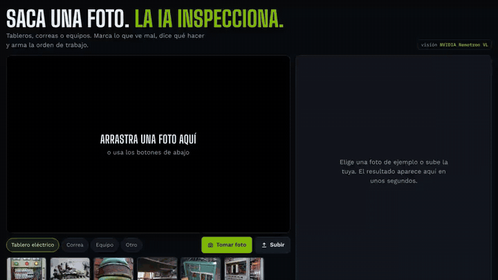
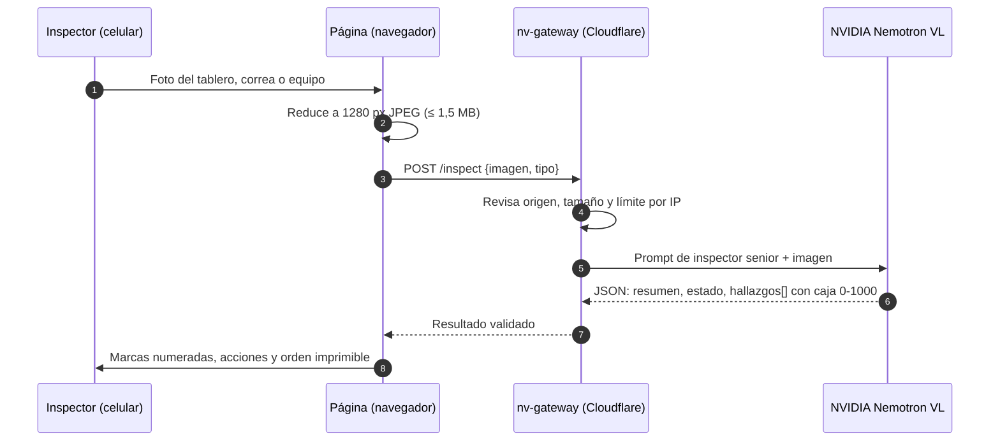

# Inspector de terreno

**Sacas una foto de un tablero, una correa o un equipo. La IA marca lo que ve mal, dice qué hacer y arma la orden de trabajo.**

**Español** · [English](README.en.md)

## El problema

Una inspección de terreno termina en una foto en el celular y una nota que alguien transcribe después. La observación pierde contexto, la severidad depende de quién la escribió y la orden de trabajo llega tarde.

## Cómo funciona

Cada hallazgo vuelve con **título, detalle, severidad (alta, media, baja), acción concreta y su caja** en coordenadas normalizadas. La página dibuja las cajas sobre la foto y arma la orden de trabajo. El modelo también declara **lo que la foto no permite confirmar**, para no inventar.

## Decisiones de diseño

| Decisión | Por qué |
|---|---|
| La página nunca ve la clave de NVIDIA | Va como secreto en [nv-gateway](https://github.com/JSNN15/nv-gateway), que solo acepta este sitio y limita las consultas. |
| Prompt según el tipo de activo | Un tablero, una correa y un equipo rotatorio tienen fallas distintas: el prompt cambia la lista de chequeo. |
| Salida en JSON con cajas 0-1000 | Independiente de la resolución, y la página dibuja sin depender del modelo. |
| Reintento si el JSON viene mal | Si la respuesta no se puede leer, el intermediario repara comas o pide de nuevo una vez. |
| Ejemplos guardados | Las 17 fotos de ejemplo (tableros, válvulas, cámaras de cables, galerías inundadas, estructuras) cargan al instante y sin gastar consultas; la foto propia sí llama a la IA. |
| Cámara en vivo | El botón Cámara abre la cámara del celular, tablet o PC en la misma página (getUserMedia, cámara trasera por defecto) y analiza el cuadro capturado. Si el navegador no lo permite, abre la cámara del sistema. |

## Límites

- La IA ve lo que está en la foto: no mide temperatura, torque ni aislación. Es un primer filtro, no reemplaza la inspección con instrumentos.
- La severidad es una propuesta del modelo; la decide el inspector.
- Las cajas son aproximadas: sirven para ubicar, no para medir.

## Archivos

| Archivo | Qué es |
|---|---|
| `index.html` | La máquina completa: interfaz, dibujo de marcas y orden de trabajo. Sin build ni dependencias. |
| `s/` | Fotos de ejemplo con su resultado guardado. |
| `docs/` | GIF de la demo y diagramas. |

Para probarla en local: `python3 -m http.server 8770` y abre `http://localhost:8770`. Las llamadas en local van a `http://localhost:8787`, donde corre `nv-gateway` con `node dev.mjs`.

## Créditos

Fotos de ejemplo (licencias de sus autores, no Apache-2.0): *Electrical Panel* (peretzp), *square-d distribution board* (h080), *Green is the colour of...* (Jens Rost), *Electric panel* (sparr0), *Open room distribution board* (seeweb), todas CC BY-SA 2.0 vía Openverse; cuadro de correa de BeltCrack (Huang y otros, 2026, CC BY-SA 4.0). Además, vía Openverse: *Old Fuse Box* (chrstphre), *DSC00360* (dcmorton), *09. Water Pumped out of Tracks* (MTAPhotos), *6120 old fuse box* (crabchick), *Chambre bien remplie* (Point d'Appui National ANT), *Old Columbus Road Lift Bridge Span* (lungstruck), *Old Rusty Valve* (Gordon M Robertson), *old fuse boxes* (johnclarkemills), CC BY 2.0; *Rusty Valve* (mikecogh), *Outdoor Gas Installation* (christian.senger), *Old fuse box* (Valerie Everett), CC BY-SA 2.0. Enlaces en el pie de la página.

---

Proyecto personal de **Julián Neira Nova**, ingeniero eléctrico con 10 años en faena · Servicio y Soluciones Tecnológicas DelaCruz SpA. Nada de lo publicado proviene de clientes ni de empleadores.
[Portafolio](https://jsnn15.github.io/) · [LinkedIn](https://www.linkedin.com/in/julian-neira-nova/) · [Todas las máquinas](https://github.com/JSNN15)
